# ⚡ BÁO CÁO GOOGLE PAGESPEED INSIGHTS (LIGHTHOUSE AUDIT) — DORMI.SPACE

> **Website:** `https://www.dormi.space`  
> **Engine:** Google Lighthouse v13.5.0 (Cốt lõi chính thức của Google PageSpeed Insights)  
> **Môi trường:** Production (Vercel CDN Edge)  
> **Thời điểm kiểm định:** 16/10/2026  
> **File báo cáo HTML trực quan:**  
> - Desktop: [`reports/lighthouse_dormi_desktop.report.html`](file:///d:/University/EXE101/Dormi/reports/lighthouse_dormi_desktop.report.html)  
> - Mobile: [`reports/lighthouse_dormi.report.html`](file:///d:/University/EXE101/Dormi/reports/lighthouse_dormi.report.html)  

---

## 1. Bảng điểm tổng quan (Overall Scorecard)

| Trụ cột đánh giá | Desktop Score | Mobile Score | Đánh giá & Trạng thái |
| :--- | :---: | :---: | :--- |
| 🚀 **Performance (Hiệu năng)** | **93 / 100** 🟢 | **60 / 100** 🟡 | **Desktop siêu tốc (<1.5s LCP)**; Mobile cần tối ưu chuyển hướng domain & tách bundle JS. |
| ♿ **Accessibility (Khả năng tiếp cận)** | **89 / 100** 🟢 | **89 / 100** 🟢 | Độ tương phản màu sắc và nhãn ARIA đạt chuẩn tốt, giao diện trực quan. |
| 🛡️ **Best Practices (Chuẩn công nghệ)** | **100 / 100** 🟢 | **100 / 100** 🟢 | **Điểm tuyệt đối 100%**: HTTPS chuẩn, bảo mật hiện đại, không có API lỗi thời. |
| 🔍 **SEO (Tối ưu tìm kiếm)** | **83 / 100** 🟢 | **83 / 100** 🟢 | Cấu trúc thẻ HTML ngữ nghĩa tốt, thân thiện với bot tìm kiếm Google. |

```mermaid
xychart-beta
    title "So sánh Điểm số Google PageSpeed giữa Desktop và Mobile"
    x-axis ["Performance", "Accessibility", "Best Practices", "SEO"]
    y-axis "Điểm số (/100)" 0 --> 100
    bar [93, 89, 100, 83]
    bar [60, 89, 100, 83]
```



---

## 2. Chi tiết các chỉ số sống còn (Core Web Vitals)

| Chỉ số Core Web Vitals | Chuẩn Google Good | Desktop Thực tế | Mobile Thực tế (Mạng 4G) | Ý nghĩa kỹ thuật |
| :--- | :---: | :---: | :--- | :--- |
| **LCP** *(Largest Contentful Paint)* | $\le 2.5\text{ s}$ | **1.5 s** 🟢 *(Good)* | **7.2 s** 🔴 *(Needs Work)* | Thời gian phần tử nội dung lớn nhất (Hero banner/Ảnh phòng) hiển thị xong. |
| **FCP** *(First Contentful Paint)* | $\le 1.8\text{ s}$ | **0.9 s** 🟢 *(Good)* | **5.1 s** 🟡 *(Moderate)* | Thời điểm pixel nội dung đầu tiên được vẽ lên màn hình. |
| **TBT** *(Total Blocking Time)* | $\le 200\text{ ms}$ | **0 ms** 🟢 *(Perfect!)* | **140 ms** 🟢 *(Good)* | Thời gian main thread bị nghẽn bởi JavaScript. Code React chạy cực mượt! |
| **CLS** *(Cumulative Layout Shift)* | $\le 0.1$ | **0.000** 🟢 *(Perfect!)* | **0.000** 🟢 *(Perfect!)* | Độ xô lệch giao diện khi tải. Giao diện ổn định tuyệt đối, không giật cục. |
| **Speed Index** | $\le 3.4\text{ s}$ | **1.3 s** 🟢 *(Good)* | **6.5 s** 🟡 | Tốc độ hiển thị nội dung trực quan toàn trang. |

---

## 3. Phân tích nguyên nhân chênh lệch giữa Desktop và Mobile

### 🎯 Điểm mạnh vượt trội:
1. **JavaScript không hề làm nghẽn Main Thread:** TBT trên desktop đạt **0ms** và mobile chỉ **140ms**, chứng minh logic React 19 và Zustand được viết rất tinh gọn.
2. **Layout Shift bằng 0 tuyệt đối (CLS = 0):** Cấu trúc CSS Tailwind thiết lập kích thước khung (aspect ratio, skeleton loader) chuẩn xác, người dùng không bao giờ bị nhảy trang khi ảnh tải xong.
3. **Best Practices 100/100:** Không có lỗi console rác, hình ảnh tỷ lệ chuẩn, giao thức HTTPS HSTS bảo mật cao.

### ⚠️ Cơ hội tối ưu hóa cho Mobile (Opportunities):

> [!TIP]
> **1. Tránh chuyển hướng nhiều lần (Avoid multiple page redirects - Tiết kiệm ~1.2 giây):**
> - Khi người dùng gõ `dormi.space`, Vercel chuyển tiếp `http://dormi.space` $\rightarrow$ `https://dormi.space` $\rightarrow$ `https://www.dormi.space`.
> - Trên mạng di động 4G/3G với độ trễ sóng cao, mỗi cú redirect HTTP tốn thêm từ 400ms đến 1.200ms trước khi byte HTML đầu tiên được tải.
> - **Khắc phục:** Cấu hình domain chính thức trên DNS Vercel thành Apex domain (`dormi.space`) hoặc luôn dẫn link chiến dịch marketing trực tiếp vào `https://www.dormi.space`.

> [!TIP]
> **2. Tách nhỏ gói mã nguồn (Reduce unused JavaScript - Tiết kiệm ~226 KiB):**
> - Trang chủ hiện đang gộp chung các thư viện nặng như Three.js (`three`, `@react-three/fiber` cho phòng 3D) và Leaflet (`leaflet` cho bản đồ).
> - **Khắc phục:** Áp dụng `React.lazy()` và dynamic `import()` cho module 3D Room Viewer và Map, chỉ tải khi người dùng cuộn đến hoặc bấm xem bản đồ/3D.

---

## 4. Kế hoạch hành động để đẩy Mobile lên 90+ điểm

1. **Domain Canonical:** Đặt `https://www.dormi.space` làm canonical URL duy nhất trên Vercel DNS để xóa bỏ độ trễ redirect 1.2s.
2. **Code-Splitting Vite:**
   Trong `vite.config.ts`, cấu hình `manualChunks` tách `three` và `leaflet` ra khỏi `vendor.js`:
   ```ts
   build: {
     rollupOptions: {
       output: {
         manualChunks: {
           three: ['three', '@react-three/fiber', '@react-three/drei'],
           map: ['leaflet'],
         }
       }
     }
   }
   ```
3. **Ảnh định dạng WebP/AVIF:** Cloudinary đã hỗ trợ tự động `f_auto,q_auto` cho hình ảnh phòng trọ, bảo đảm dung lượng ảnh siêu nhẹ trên điện thoại.
